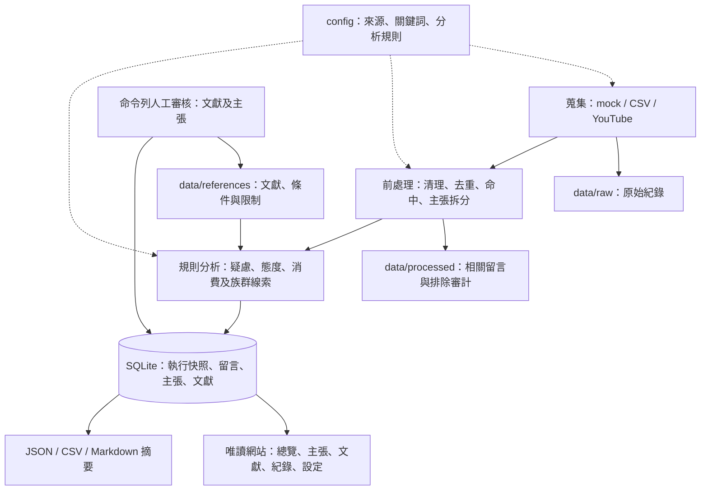

# 第一階段架構與資料關聯

關聯：一個執行包含多則留言；一則留言拆成多個主張片段；每個片段可有多個候選文獻與正式引用；審核事件按主張 ID＋內容指紋保存。不同執行的設定及文獻各有快照。

設定、程式、呈現相互分離；網站不寫入設定與資料庫。人工維護採命令列。Demo 與人工匯入可完全離線（安裝依賴後）；YouTube 蒐集需要連網與外部 API。

第一階段保留人工判讀：規則只做可解釋初篩。科學證據程度、語意例外和分類修正由人工負責。介面不呈現油種排名、未經校準的可信度分數或推估購買影響。
